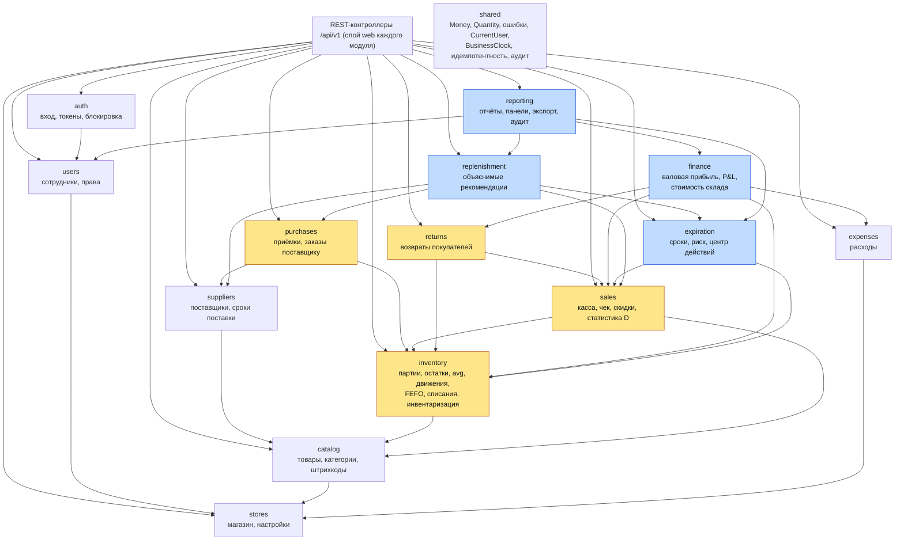
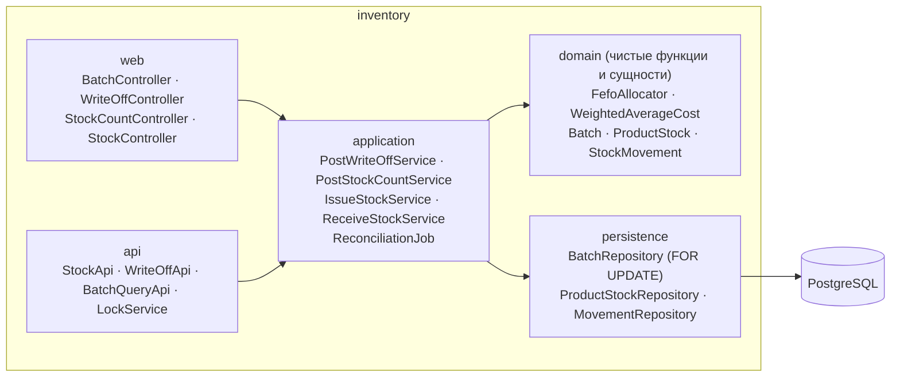

# Компоненты backend: модули и зависимости (C4, уровень 3)

Стрелка «A → B» означает: модуль A вызывает публичный `api` модуля B. Граф ацикличен; проверяется ArchUnit в CI. Модуль `shared` (деньги, ошибки, контекст магазина, время, идемпотентность, аудит, нумерация) используют все модули, на схеме его стрелки опущены.

Жёлтым — модули, меняющие остатки под блокировками; синим — модули, которые только читают и вычисляют.

## Компоненты модуля inventory (пример внутреннего устройства)

