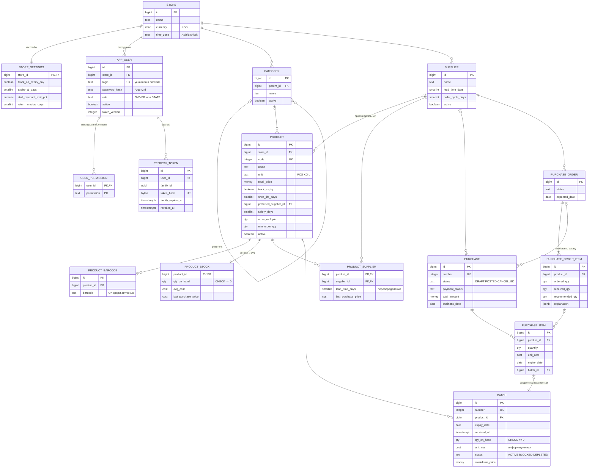
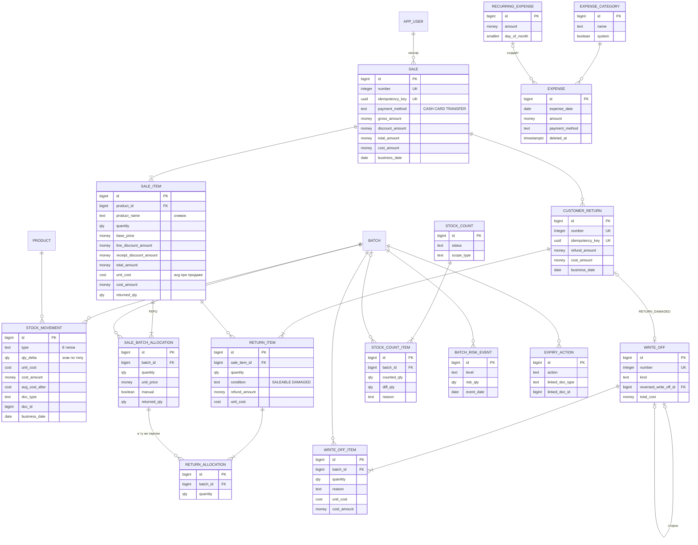
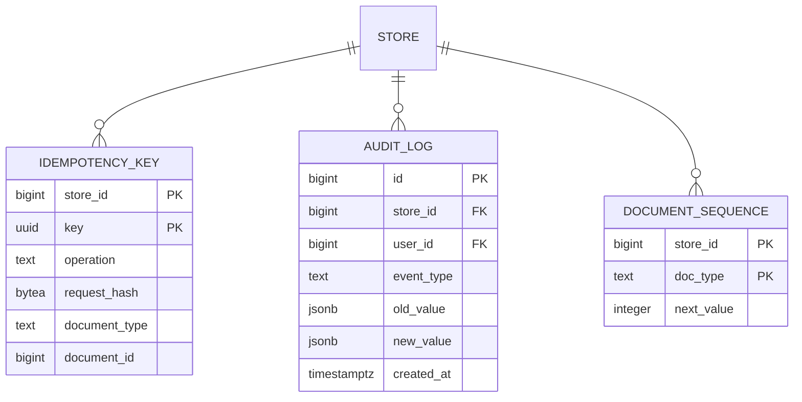

# ER-диаграмма

Основные сущности и связи. Типы упрощены для читаемости: `money` = `numeric(14,2)`, `cost` = `numeric(14,4)`, `qty` = `numeric(12,3)`. Почти у каждой таблицы есть `store_id` и составной внешний ключ `(store_id, x_id)`; на диаграмме `store_id` показан только у корневых сущностей. Полное описание колонок и ограничений — [`../DATABASE.md`](../DATABASE.md).

## Справочники, пользователи, закупки

## Движения, продажи, возвраты, списания, расходы

## Платформа

