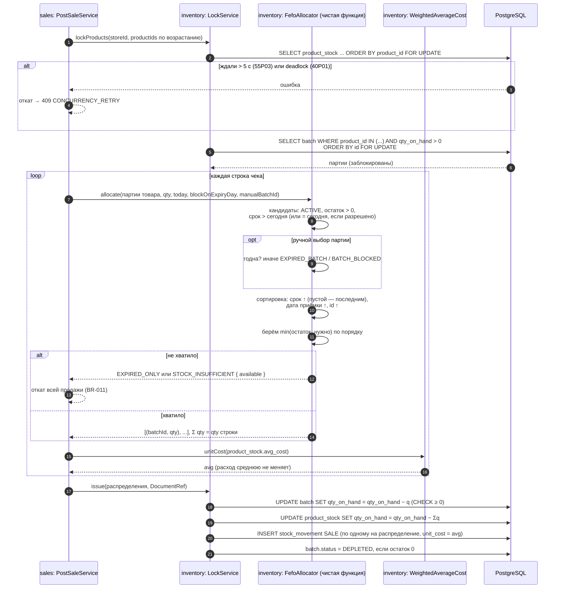

# Последовательность: распределение FEFO

Внутри транзакции продажи (шаг `allocateAndIssue` в [sequence-pos-sale.md](sequence-pos-sale.md)). Физическое распределение (какая партия) и учётная оценка (по какой себестоимости) разделены: цена партии в себестоимость не входит (`ALGORITHMS.md`, раздел 1).

